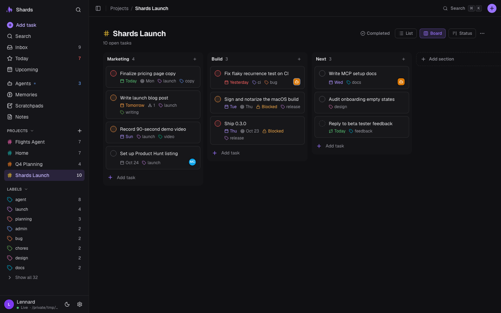

# Shards

**The multiplayer task manager for humans and agents, backed by Markdown you own.**

> **Status:** CLI and MCP shipped (0.2.0). On this branch: task model v2 (due dates, deadlines,
> recurrence, subtasks, sections, `urgent`) and a working desktop-app prototype (macOS first),
> both uncommitted. Sync, hosted MCP and teams are planned. See [Roadmap](#roadmap).

Shards gives you Todoist-grade task management in a folder of plain Markdown files. Your AI
agents use the same folder as first-class teammates. You plan in the app. Your agents claim,
work and finish tasks through the CLI or MCP. Their memories and scratchpads live in the same
vault, next to your notes. No database is the source of truth, and no account is required. You
can open, grep, version or sync every file with any tool you already use.

## What Shards is

One Rust core with three surfaces:

| Surface | For | Status |
|---|---|---|
| **Desktop app** (`apps/desktop`, Tauri 2 + React) | People. A monochrome UI (colour only for priority, due dates, agent state and errors). Sidebar: Search, Tasks (Inbox, Today, Upcoming, Projects, Labels), Agent team (Agents, Memories, Scratchpads) and Library (Notes), with collapsible sections. Lists and boards have Display (group, sort, density) and filter menus. Notes have Folders and nested Tags trees. Also ⌘K, quick add, a detail pane, and live refresh when an agent edits a file. Agents are visible as teammates: what each one is working on, plus its memories and scratchpads. | **Prototype** (feature 16): runs in Tauri or a browser; unsigned debug builds only |
| **`shards` CLI** | Scripts, terminals and agents. Granular verbs over five spaces, `--json` everywhere, cold start under 10 ms, no daemon. | Shipped (0.2.0) |
| **`shards-mcp`** (stdio MCP server) | Agents in Claude Code, Cowork and any MCP client. 40 `shards_*` tools over the same verbs. | Shipped (0.2.0) |

The folder is divided into five **spaces**: `notes`, `tasks`, `memories`, `scratch` and `assets`.

- **Tasks = coordination + handoff.**
  - A task has an accountable `owner` (human or agent) and an optional `claimed_by` delegate.
  - It carries a live dependency graph: `claim` / `release` / `finish` / `cancel`,
    `block` / `unblock`, derived readiness and `task next`.
  - Task model v2 (feature 15, on this branch): `urgent` priority, `due` (date or date-time),
    `deadline`, `recur` (an RRULE subset), subtasks (`parent`), `section` and manual `order`.
- **Notes + memories + search = recall.**
  - Notes are durable knowledge.
  - Memories are an agent's beliefs about the operator and the fleet. They are ranked by match,
    importance and recency.
- **Scratch and assets are the working surface.** Scratch holds per-agent session state. Assets
  are content-addressed files beside the vault.
- **Markdown is the source of truth.** Shards owns the interface and the writes, not the data.

Ranked search goes to the first-party [`indexed`](https://github.com/LennardZuendorf/indexed)
engine when one is configured. Without it, Shards falls back to a built-in BM25-lite engine that
needs nothing installed. Shards coexists with anything else that writes the folder: a Markdown
editor, git, another MCP server.

## Quick start

**CLI and MCP** (Rust 1.94+, or prebuilt binaries — see [Install](#install)):

```bash
cargo install --path .           # installs `shards` and `shards-mcp`
shards init                      # writes ~/.shards/config.toml and creates the vault
shards task new "Ship the rename" --priority high
shards task list --json
```

To wire Shards into Claude Code, install the plugin. It runs `shards-mcp` over stdio (see
[MCP](#mcp)). Full details are in [Install](#install) and [First run](#first-run) below.

**Desktop app** (prototype; needs Rust 1.94+, Node 24 and pnpm). Build a demo vault first, then
pick a mode. Each mode is a long-running process: stop it with Ctrl-C when you are done.

```bash
cargo build                                    # the demo script drives target/debug/shards
bash scripts/demo-vault.sh --force             # /tmp/shards-demo/{config.toml,vault}; --empty for first run
pnpm -C apps/desktop install

# 1. Browser mode: shards-host (HTTP + SSE on 127.0.0.1) and Vite (http://localhost:5173)
cargo run -p shards-host -- --config /tmp/shards-demo/config.toml            # port 7878
pnpm -C apps/desktop dev                                                    # second terminal
#    other ports: shards-host --port 7901, then (no `--` before --port, or Vite stays on 5173)
#    SHARDS_HOST_URL=http://127.0.0.1:7901 pnpm -C apps/desktop dev --port 5201 --strictPort

# 2. Desktop window in dev mode (Vite on 5173 + the Tauri shell)
SHARDS_CONFIG_PATH=/tmp/shards-demo/config.toml pnpm -C apps/desktop tauri dev

# 3. A built app bundle (unsigned, debug)
pnpm -C apps/desktop tauri build --debug --bundles app
SHARDS_CONFIG_PATH=/tmp/shards-demo/config.toml \
  ./target/debug/bundle/macos/Shards.app/Contents/MacOS/shards-desktop
```

`shards-host` writes a per-launch token to `~/.shards/run/host-<port>.token` (mode 0600). The
Vite dev proxy reads it and adds the `x-shards-token` header, so the browser never holds it.
The host refuses non-loopback `Host` headers and foreign origins. The app acts as `[core].me`
from the config (the demo sets `me = "lennard"`). Point either mode at your own vault with
`--config` / `SHARDS_CONFIG_PATH`.

**Upgrading from mesh?** Your vault needs no changes. Six steps:

```
Upgrading from mesh 0.2 → Shards 0.3
  1. Binaries:   mesh → shards, mesh-mcp → shards-mcp (reinstall: ./scripts/install.sh)
  2. MCP config: "command": "mesh-mcp"  →  "command": "shards-mcp", server key "shards"
  3. Allowlists: mcp__mesh__*  →  mcp__shards__*   (tool names: mesh_* → shards_*)
  4. Plugin:     reinstall "shards" from the marketplace
  5. Env:        MESH_* → SHARDS_*   (MESH_* still read in 0.3.x, removed in 0.4.0)
  6. Home:       mv ~/.mesh ~/.shards (~/.mesh still read in 0.3.x, removed in 0.4.0)
  Your vault needs no changes.
```

`MESH_*` and `~/.mesh` are read in 0.3.x and removed in 0.4.0. A one-line deprecation notice on
the error stream is planned (not built yet). MCP tool names have no `mesh_*` alias.

## Screenshots

The desktop prototype on the demo vault (`scripts/demo-vault.sh`). These shots predate the monochrome redesign and are due for a refresh.

| | |
|---|---|
|  |  |
| **Today**: overdue and today's tasks, priorities, labels, assignees | **Project board**: sections as columns, drag to reorder |
|  |  |
| **Agents**: what each agent is working on, awaiting input or stuck on | **Memories**: every agent's beliefs, with kind, importance and expiry |
|  |  |
| **Upcoming**: the next days, recurring tasks marked | **Quick add** (`q`): `#project /section @label p1 +assignee fri 10am every week {deadline}` |

## Roadmap

The plan lives in [`.spec/plan.md`](.spec/plan.md). In short:

| Horizon | Features |
|---|---|
| **Now** | Rebrand to Shards (14); task model v2 with due dates, deadlines, recurrence, subtasks, sections and `urgent` priority (15); desktop app with a completed log, project management, bulk actions and reminders while the app is open (16) |
| **Next** | App polish: tray reminders, global quick add, saved filters, view options, task links, calendar, importers, signed macOS build (17). Personal multi-device sync (18). Hosted remote MCP with OAuth (19). Phone capture and a review web app (19b) |
| **Later** | Multiplayer workspaces (20); full web and native mobile apps (21, target Q4 2027); integrations (22); end-to-end encryption (23) |

Pricing intent: **Local** stays free forever (MIT, no account). **Personal Sync** is planned at
$5/mo and includes a hosted MCP endpoint. **Team** is planned at $8 per human seat, and agents
are free members.

## What Shards does not do (yet)

Six things to know before you point it at a folder you care about.

- **It does not verify who is calling, locally.**
  - `owner` and `claimed_by` are strings that a caller supplies.
  - `[tasks].collections` checks the *spelling* of `--owner` against a roster. Nothing checks
    that the process passing `--owner alice` is alice, and nothing checks `claimed_by` at all.
  - Treat a claim as a cooperation signal between agents you already trust on one machine. It is
    not proof of authorship and not a security boundary.
  - Verified identity arrives with the server (features 18–19): there the actor comes from an
    OAuth token.
- **Two search engines can answer one query differently.**
  - The built-in engine applies `--space`. The `indexed` path ignores it.
  - By default, `shards reindex` hands `indexed` the whole vault root.
  - So with a collection configured, a search can return rows from spaces you filtered out,
    including scratch. `shards search --health` tells you which engine would answer.
- **Lenses read Shards-authored entities only.**
  - Point `notes` at an existing vault, and `shards search` (plus `note get/list --foreign`) sees
    every file in it.
  - But `graph`, `build-context`, `project` and `session-start` resolve by Shards id. Adopted
    Markdown stays outside the coordination layer until Shards itself writes entities there.
  - `shards status` makes the split visible: `notes: N (shards-native)` plus a
    `foreign markdown` count.
  - A lens seed that names a foreign file answers `seed is not shards-native (no shards id)`
    instead of `seed not found`.
- **A Markdown file over 4 MiB is invisible.**
  - The walk skips it, so it is absent from every list, search and lens, and `note get` on its id
    reports "not found". There is no diagnostic and no count.
  - Shards refuses to *write* past that limit. A file that an external editor grows past the
    limit simply disappears from Shards's view.
- **CLI and MCP delete is a hard `unlink`.**
  - There is no trash, no soft-delete and no promised recovery. Backup is the vault owner's job.
    In an unversioned vault, a deleted note cannot be recovered.
  - The desktop app offers undo for its own deletes by writing the original bytes back. Its
    deletes are planned to move the file to the operating system's Trash instead of unlinking it,
    so an app delete stays recoverable after the app quits (`.spec/plan.md`, desktop-app/31).
- **Windows is not supported.** The Now horizon targets macOS first. Linux is best-effort: it
  stays green in CI, but the desktop app does not target it yet.

---

The spec is the source of truth: see [`.spec/`](.spec/). Working in here? Read
[`AGENTS.md`](AGENTS.md) first. For architecture Q&A, see [`docs/concepts.md`](docs/concepts.md).
It covers spaces, memories vs. notes vs. scratch, assets, derived readiness, atomicity, and
vault/config resolution.

---

## Install

### Prebuilt binaries (no Rust toolchain)

Every tagged release attaches `shards` and `shards-mcp` for Linux x86-64, Linux arm64 and macOS
on Apple silicon, plus a `SHA256SUMS` file:

| Platform | Archive |
|---|---|
| Linux x86-64 | `shards-v<VERSION>-linux-x86_64.tar.gz` |
| Linux arm64 | `shards-v<VERSION>-linux-aarch64.tar.gz` |
| macOS, Apple silicon | `shards-v<VERSION>-macos-aarch64.tar.gz` |

The two Linux archives are **static** (musl) builds: no glibc version floor, so they run on any
distribution — Alpine, Amazon Linux, Debian, Ubuntu 20.04 or 24.04, RHEL, a container with no
libc to speak of. The macOS archive targets Apple silicon.

```bash
VERSION=0.2.0
PLATFORM=linux-x86_64     # or linux-aarch64 / macos-aarch64
BASE="https://github.com/LennardZuendorf/shards/releases/download/v$VERSION"

curl -fsSLO "$BASE/shards-v$VERSION-$PLATFORM.tar.gz"
curl -fsSLO "$BASE/SHA256SUMS"
sha256sum -c --ignore-missing SHA256SUMS          # macOS: shasum -a 256 -c --ignore-missing SHA256SUMS
tar -xzf "shards-v$VERSION-$PLATFORM.tar.gz"
install -m 755 shards shards-mcp ~/.local/bin/    # or /usr/local/bin (with sudo)
shards --version
```

`SHA256SUMS` lists all three archives for the release, so `--ignore-missing` checks the one you
downloaded. Both binaries are self-contained: no runtime, no daemon, no database.

### From source

Intel Macs, Windows and any platform not in the table above build from source. Requires
**Rust 1.94+** (the toolchain is pinned in [`rust-toolchain.toml`](rust-toolchain.toml)).

```bash
cargo install --path .        # installs `shards` and `shards-mcp` into ~/.cargo/bin
# or, without installing:
cargo build --release         # ./target/release/shards and ./target/release/shards-mcp
```

`scripts/install.sh` is a one-line wrapper around the first form.

**Name clash.** Crystal's package manager also installs a `shards` binary. If `shards --version`
does not print Shards, put the directory you installed into (`~/.local/bin` or `~/.cargo/bin`)
before the Crystal bin directory in `PATH`.

Two binaries are produced from one crate: **`shards`** (everything, including `shards mcp`) and
**`shards-mcp`** (a shim that runs the same stdio MCP server, so the bundled `.mcp.json` needs no
edit). Shell completions come from `shards completions {bash,zsh,fish,powershell,elvish}`.

## First run

```bash
shards init
```

`init` writes `~/.shards/config.toml` (or `$SHARDS_CONFIG_PATH` when set), creates the vault
directory — and nothing else; the space folders are created lazily on first write, so pointing
shards at an existing folder scatters no empty directories. Re-running is always safe: with an
existing config and no `--force`, it refuses (exit 2) and never opens the file for writing.

```
shards init [--path PATH] [--agent ID] [--collections CSV] [--search-collection NAME]
          [--hybrid | --no-hybrid] [--threshold FLOAT] [--engine ENGINE]
          [--spaces | --no-spaces] [--obsidian] [--force]
```

The rendered config:

```toml
[core]
vault_path = "/home/you/.shards/vault"
agent = "my-agent"

[spaces]
notes = "notes"
tasks = "tasks"
memories = "memories"
scratch = "scratch"
assets = "assets"

[search]
hybrid = true

[tasks]
collections = []
```

`[search].threshold`, `collection` and `engine` are written only when you ask for them
(`--threshold`, `--search-collection`, `--engine` other than `auto`). `--no-spaces` leaves the
`[spaces]` block out entirely — the defaults are identical either way. `--obsidian` is shorthand
for `notes = "."`: the notes space *becomes* the vault root, so an existing Markdown vault is
exposed as-is and the other four spaces sit inside it as strict subfolders (the notes walk skips
them, so `shards note list` never lists your tasks).

Then:

```bash
shards note new "hello" --body "first note" --type note
shards task new "do something" --body "details" --priority high
shards memory new "operator prefers terse output" --kind preference --importance 4 --body "Terse. No prose."
shards task list
shards search "something"
```

---

## Config

Config lives at `~/.shards/config.toml`. A missing config exits 2 with a three-line message naming
the resolved path and the required key. A committed reference copy — every key `src/config.rs`
reads, documented — is [`config.example.toml`](config.example.toml); `config.toml` itself is
gitignored, since it names a real vault path and identity.

```toml
[core]
vault_path = "~/shards-vault"   # required; ~-expanded then canonicalised at load
agent      = "my-agent"       # optional; the default owner/claimer identity

[spaces]                      # entirely optional; every key optional
notes    = "notes"            # relative path | absolute path | "." | false
tasks    = "tasks"
memories = "memories"
scratch  = "scratch"
assets   = "assets"

[search]
collection = "my-vault"       # optional; unset ⇒ `indexed` is never invoked
hybrid     = true             # default true
# threshold = 0.65            # deliberately unset; applies only when written
engine     = "auto"           # auto | indexed | builtin | substring
spaces     = ["notes", "tasks", "memories", "assets"]   # the default search corpus

[tasks]
collections = ["my-agent", "peer"]   # roster of valid --owner values; [] = open roster
strict      = false                  # default for `task claim --strict`
```

**`[spaces]` semantics**, per key, in order:

| Value | Meaning |
|---|---|
| absent | the built-in default (`notes`, `tasks`, `memories`, `scratch`, `assets` under the vault) |
| `"subdir"` | a path relative to `vault_path` |
| `"/abs/path"` | an absolute folder, `~`-expanded; added to the sandbox explicitly and listed by `shards status` |
| `"."` or `""` | the vault root itself |
| `false` | the space is **disabled** — every verb for it exits 2 with `space 'scratch' is disabled in [spaces]`, and it contributes no sandbox root and no search corpus |

Three checks run at load, all exit 2 before any I/O: two enabled spaces may not resolve to the
same directory (except that the notes space may be the vault root while the others are strict
subfolders of it); when notes *is* the vault root, every other enabled root must be a strict
descendant and is excluded from the notes walk; and a relative root may not resolve outside
`vault_path`. Type and status routing is always relative to the **space root**, never the vault
root — with `notes = "."`, `note new --type log` lands in `<vault>/logs/`.

An omitted `[spaces]` table, or any omitted key, resolves to the layout the Python-era version used —
**a pre-rewrite config behaves identically with zero edits.**

**Environment and global flags**

| Var / flag | Effect | Precedence |
|---|---|---|
| `--config PATH` | config file location | above everything |
| `SHARDS_CONFIG_PATH` | config file location, `~`-expanded, only when non-empty | above `~/.shards/config.toml` |
| `--vault PATH` | `[core].vault_path` | above `SHARDS_VAULT` |
| `SHARDS_VAULT` | `[core].vault_path` | above the file |
| `SHARDS_AGENT` | `[core].agent`, only when non-empty | above the file |
| `SHARDS_INDEXED_BIN` | the `indexed` binary to invoke | above the `PATH` lookup |
| `EDITOR` / `VISUAL` | interactive body for `note new` / `memory new` / `scratch set` | `VISUAL`, then `EDITOR` |
| `XDG_RUNTIME_DIR` | `shards watch` lock directory, else `~/.shards/run/` | — |

`[core].path` and `[core].tolaria_path` are permanent input aliases for `vault_path`
(precedence `vault_path` > `path` > `tolaria_path`, no warning). Unknown tables and keys are
ignored, never rejected, so a fleet mid-upgrade keeps working; a leftover `[daemon]` table is
inert. A `vault_path` that exists and is not a directory is a config error (exit 2).

`shards config show` prints the *effective* config after the environment overlay, plus every
resolved space path and the sandbox roots — the fastest way to answer "where will my write
land". `shards config set core.agent value` edits the file in place, preserving comments and key
order.

---

## CLI surface

`shards --help` is always the source of truth for the live command list; this is the shape.

```
shards [--version] [--json] [--quiet] [--owner ID] [--mine] [--config PATH] [--vault PATH] <command>
```

`--json`, `--quiet`, `--owner` and `--mine` are accepted **on either side of the command name**
on every non-admin command, with identical effect. Admin commands (`init`, `status`, `reindex`,
`watch`, `dashboard`, `config`, `completions`, `mcp`) take them on the global side only.

**Output classes.** Every command declares one, so precedence is never a guess:

| Class | Commands | Rule |
|---|---|---|
| **M** — mutation | create, append, update, claim, release, finish, cancel, delete, block, unblock, `scratch set`, `asset add`/`attach`/`detach`, `config set` | `--quiet` beats `--json`. Quiet prints the id (or name) alone; JSON is `{"id", …fields, "updated"}` in that order |
| **L** — listing / lens / object / admin | `get`, `list`, the five lenses, `task next`, `asset path`, `asset gc`, `init`, `status`, `reindex`, `watch`, `config` | `--json` beats `--quiet` |
| **S** — search | `search`, `memory recall` | output is *always* one JSON array line; `--json` is accepted and inert; `--quiet` suppresses only the stderr degradation notice |

Timestamps render identically everywhere: `YYYY-MM-DDTHH:MM:SS[.ffffff]Z`, microseconds only when
non-zero. Human previews are a plain 200-code-point slice of the body.

### `shards note`

`new` · `append` · `update` · `get` · `list` · `delete`

```
note new    TITLE  [--type note|log|decision|reference|project] [--tags CSV] [--owner ID]
                   [--body TEXT] [--file PATH]
note append TARGET TEXT [--section S] [--timestamp]
note update TARGET [--tags SPEC] [--type T] [--title TEXT]
note get    TARGET [--full] [--meta-only] [--related] [--foreign]
note list   [--tags CSV] [--any-tag] [--owner ID] [--type T] [--since DUR|ISO]
            [--sort updated|created|title] [--limit 20] [--foreign]
note delete TARGET [--force]
```

`TARGET` is an `n-` id or a title slug. Types route into folders under the notes root: `note` →
`<notes>/`, and `log`/`decision`/`reference`/`project` → `logs/`, `decisions/`, `references/`,
`projects/`. Rows are `{id}··{type}··{title}` (two spaces).

`--tags` on `update` is a grammar, not a list: bare `x,y` **merges** (additive, idempotent),
`=x,y` replaces the whole list, `+x,-y` is a per-token delta. A mixed spec is exit 2 rather than
a guess.

`--foreign` surfaces non-shards Markdown living in the notes space (`id: null`, title from the
first `# H1`, else the filename stem). Foreign files stay invisible to every mutating verb.
`note update --title` prints one stderr advisory when the rename dangles `[[Old Title]]`
backlinks — an advisory, never a refusal: shards does not rewrite bodies it did not write.

### `shards task`

`new` · `update` · `append` · `claim` · `release` · `finish` · `cancel` · `get` · `list` ·
`delete` · `block` · `unblock` · `next`

```
task new     TITLE [--priority urgent|high|normal|low] [--tags CSV] [--owner ID] [--body TEXT]
                   [--project ID] [--blocks CSV] [--blocked-by CSV]
                   [--due DATE] [--deadline DATE] [--recur RRULE] [--recur-from due|completion]
                   [--parent ID] [--section NAME] [--order NUM]
task update  TASK_ID [--priority P] [--tags SPEC] [--title T] [--project ID] [--owner ID]
                     [--blocks CSV] [--blocked-by CSV] [--status open]
                     [--due DATE] [--deadline DATE] [--recur RRULE] [--recur-from due|completion]
                     [--parent ID] [--section NAME] [--order NUM]      ("" clears each)
task append  TASK_ID TEXT [--section S] [--timestamp]
task claim   TASK_ID [--strict | --no-strict]
task release TASK_ID [--force] [--note TEXT]
task finish  TASK_ID [--outcome TEXT] [--expected-due DUE]
task cancel  TASK_ID [--reason TEXT]
task get     TASK_ID [--full] [--meta-only]
task list    [--status CSV] [--owner ID] [--mine] [--tags CSV] [--any-tag] [--project ID]
             [--since DUR|ISO] [--stale DUR|ISO] [--available] [--ready] [--blocked]
             [--due-before DATE] [--due-after DATE] [--overdue] [--has-due]
             [--parent ID] [--section NAME]
             [--sort updated|created|title|priority|due|order] [--limit 20]
task delete  TASK_ID [--force]
task block   TASK_ID --on CSV
task unblock TASK_ID [--on CSV] [--all]
task next    [--claim] [--strict] [--mine] [--project ID] [--tags CSV]
```

`TASK_ID` is id-only — a title slug never resolves a task. Status routes the file:
`open`/`claimed` live in `<tasks>/open/`, `done`/`cancelled` in `<tasks>/done/`, each walked
non-recursively. Rows are `{id}\t{status}\t{claimed_by|-}\t{title}`.

`claim` is an atomic test-and-set under an `O_EXCL` lock: reclaiming your own task is a no-op
that does not rewrite the file, and another agent's claim is exit 4. `release`, `finish` and
`cancel` are idempotent the same way — a second `finish` adds no second `## Outcome` section and
does not bump `updated`. `--since` is a recency floor, `--stale` its exact inverse.

**Priorities** (highest first): `urgent`, `high`, `normal`, `low`. They map Todoist's P1–P4, and
`--sort priority` puts unset last.

**Task model v2 fields** are optional and written only when set:

- `due`: `YYYY-MM-DD` or `YYYY-MM-DDTHH:MM`, floating local time (no zone). `deadline`:
  `YYYY-MM-DD`, a hard limit separate from `due`.
- `recur`: an RRULE subset: `FREQ=DAILY|WEEKLY|MONTHLY|YEARLY`, `INTERVAL=n`, `BYDAY=MO,WE`
  (weekly), `BYMONTHDAY=1,-1` (monthly), `BYMONTH=2;BYMONTHDAY=29` (yearly). Anything else is
  exit 2. `recur_from`: `due` (default, Todoist "every") or `completion` ("every!").
- `parent` (an existing task id, no self or cycle), `section` (free text) and `order` (a number;
  lower sorts first).
- `completed`: set on finish, cleared on reopen (`task update ID --status open`).

**Finishing a recurring task** does not close it. `due` moves to the next occurrence (and
`deadline` by the same number of days), any claim is released, `completed` is set, the body is
not touched, and the result reports `next_due`. A day that does not exist in a month clamps to
the last day, and the rule is then stored with that day pinned, so the series does not drift.
Each finish advances once more, so a caller that may retry passes `--expected-due` (the `due` it
saw): when the stored `due` differs, the finish writes nothing and warns. A stored `recur` that
does not parse never blocks a finish: the task closes and a warning says why.

### The task dependency graph

`blocked_by` is authoritative; `blocks` is a best-effort mirror maintained one file at a time,
under that file's own lock. **Readiness is derived, never stored** — it is computed at read time
from the union of both edge directions, so no verb ever writes another entity's file as part of
its own transaction and there is no stored flag to go stale.

- `task block T --on B1,B2` adds edges (additive, order-preserving); `task unblock T --on B1` or
  `--all` removes them. Both are idempotent, and a self-edge or a cycle is exit 2
  (`dependency cycle: t-a -> t-b -> t-a`).
- `task list --ready` = `--available` **and** unblocked; `task list --blocked` = open or claimed
  with at least one unsatisfied blocker. `--available` stays deliberately dependency-blind.
- `task get` prints a `ready: true|false` line and appends `"ready"` last in `--json`.
- `task claim --strict` refuses a blocked task with **exit 5**, writing nothing. Without
  `--strict` the claim succeeds and prints `task t-x is blocked by t-a, t-b` on stderr. The
  default comes from `[tasks].strict`.
- `task finish` / `task cancel` report the tasks their completion unblocked as
  `"unblocked": [...]` — a report, not a cascade of writes.
- `task next` is the "give me work" primitive: it selects the highest-priority ready, unclaimed
  task and, with `--claim`, takes it in the same invocation, retrying across candidates when it
  loses a race. Nothing ready is exit 3 (`no ready task`).

### `shards memory`

`new` · `append` · `update` · `get` · `list` · `recall` · `forget`

```
memory new    TITLE [--kind fact|preference|procedure|insight|episode] [--scope shared|private]
                    [--importance 1..5] [--source TEXT] [--expires DUR|ISO] [--supersedes m-ID]
                    [--tags CSV] [--owner ID] [--body TEXT] [--file PATH]
memory append TARGET TEXT [--section S] [--timestamp]
memory update TARGET [--tags SPEC] [--title T] [--kind K] [--scope S] [--importance N]
                     [--source TEXT] [--expires DUR|ISO|none] [--owner ID]
memory get    TARGET [--full] [--meta-only] [--related]
memory list   [--kind K] [--scope S] [--tags CSV] [--any-tag] [--owner ID] [--mine]
              [--min-importance N] [--since DUR|ISO] [--include-expired] [--include-superseded]
              [--sort updated|created|title|importance] [--limit 20]
memory recall QUERY [--kind K] [--tags CSV] [--owner ID] [--mine] [--min-importance N]
                    [--limit 10] [--threshold F] [--no-decay] [--include-expired]
                    [--meta-only] [--full]
memory forget TARGET [--force] [--expired]
```

A memory is a note-shaped Markdown file with the id prefix `m-`, laid out **flat** in the
memories space — no identity-derived folders, so a typo'd `$SHARDS_AGENT` cannot fork a namespace,
and no memory verb ever moves a file. Reads are recursive, so filing memories into subfolders by
hand keeps working. `TARGET` is an `m-` id or a title slug.

| field | default | meaning |
|---|---|---|
| `kind` | `fact` | `fact` \| `preference` \| `procedure` \| `insight` \| `episode`; closed on write, free-form on read |
| `scope` | `shared` | `private` is hidden from listings whose effective owner differs — a courtesy filter, never a security boundary |
| `importance` | `3` | 1..5; a sort and ranking key, never a cutoff |
| `source` | `null` | free text: an id, a URL, a session label. Never interpreted |
| `expires` | `null` | soft TTL; expired memories drop out of `list` and `recall`, and **nothing is ever deleted automatically** |
| `superseded_by` | `null` | set by `memory new --supersedes m-OLD`; excluded from recall and default listings, kept for the audit trail |

There is no `use_count`, no `last_used` and no touch-on-read: a read verb that writes would break
idempotence, contend locks and dirty git on every hit. `recall` ranks

```
importance_weight = 0.6 + 0.1 * importance          # 0.7 .. 1.1
recency           = 0.5 ^ (age_days / 90)           # age from `updated`, not `created`
final             = match_score * importance_weight * (0.35 + 0.65 * recency)
```

so a re-confirmed memory stays hot; `--no-decay` drops the recency term for audits. Decay is
ranking, never deletion — expiry, supersession and `memory forget` are the only ways a memory
leaves recall. `memory forget --expired` is the bulk sweep, under the same delete guard.

### `shards scratch`

`set` · `append` · `get` · `list` · `clear`

```
scratch set    NAME [--body TEXT] [--file PATH] [-] [--agent ID]
scratch append NAME TEXT [--section S] [--timestamp] [--agent ID]
scratch get    NAME [--agent ID]
scratch list   [--agent ID] [--all-agents] [--since DUR|ISO]
scratch clear  NAME [--force] [--agent ID]
```

Scratch is name-addressed, not id-addressed: the file lives at
`<scratch>/<slugify(agent)>/<slugify(name)>.md` and carries a six-key frontmatter block
(`type`, `name`, `agent`, `tags`, `created`, `updated`) so one reader, one row parser and one
filter path serve the whole system. Both path components are validated the same way: a name —
or an `--agent` identity — that slugifies to empty is exit 2, never a silent collapse to a
shared file.

`set` is a whole-body overwrite and is idempotent — an identical body leaves the file's bytes
untouched. `-` reads the body from stdin (the one place shards reads stdin outside `shards mcp`).
`get` prints the body **verbatim**, with no preview truncation. `--agent ID` addresses a peer's
namespace for both reads and writes; identity here is a convention, not a boundary.

Scratch is excluded from the default search corpus, from `recent-activity`, `graph`,
`build-context` and `session-start`. It is a workbench, not memory — `search --space scratch`
opts in explicitly.

### `shards asset`

`add` · `get` · `path` · `list` · `attach` · `detach` · `remove` · `gc`

```
asset add    PATH [--title T] [--tags CSV] [--owner ID] [--caption TEXT] [--attach ID]
asset get    ASSET_ID [--meta-only] [--full]
asset path   ASSET_ID
asset list   [--tags CSV] [--any-tag] [--owner ID] [--mine] [--media-type MT]
             [--since DUR|ISO] [--sort updated|created|title|bytes] [--limit 20]
asset attach ASSET_ID TARGET [--section S]
asset detach ASSET_ID TARGET
asset remove ASSET_ID [--force]
asset gc     [--apply]
```

An asset is a blob plus a sidecar sharing one stem:

```
assets/a-7Q3KDX9M.png     the bytes, verbatim
assets/a-7Q3KDX9M.md      an ordinary shards entity: filename, media_type, bytes, sha256, blob
```

**The id is the content address** — `a-` plus Crockford base32 of `sha256(bytes)` — so
`asset add` is idempotent by content: identical bytes return the same id, write nothing, do not
bump `updated`, exit 0, and say so on stderr. Ingest is **copy only**; `move` and `link` were
rejected as a data-loss footgun. The blob is written **before** the sidecar, and a failed sidecar
write unlinks the blob: a crash can leave an orphan blob that `asset gc` finds, never a sidecar
pointing at nothing. The source extension is kept only when it is lowercase `[a-z0-9]{1,12}`;
the original filename is preserved in frontmatter as data, never as a path component, so a
hostile filename can never traverse.

`asset attach a-X TARGET` appends `![[a-7Q3KDX9M.png]]` to the target's body through the ordinary
append path and links both `related` lists. Assets sit outside those lenses' default space set,
so pass `--space notes,tasks,memories,assets` to see the pair in `graph`/`build-context`. `asset path` prints the absolute blob path and nothing else — that is what gets piped into
an image tool. `asset remove` on a still-referenced asset is exit 2 unless you pass `--force`.

### `shards search`

```
shards search [QUERY] [--type T] [--tags CSV]... [--owner O] [--status CSV] [--kind K]
            [--project ID] [--space CSV] [--engine auto|indexed|builtin|substring] [--limit 10]
            [--threshold F] [--meta-only] [--full] [--health]
```

Output is **always** one JSON array line on stdout. `--tags` is comma-split *and* repeatable and
every tag is ANDed; `--status` is a CSV union whose unknown value is exit 2, exactly as on
`task list`. With no query it becomes an exact tag pull (`score = 1.0`, metadata only). Hit keys,
in order: `id`, `type`, `title`, `score`, `path` always; then `tags`, `owner`, `updated`,
`snippet` and `space` when they apply. There is no `body` key — `--full` overloads `snippet`.
`--project ID` scopes hits to one project's envelope — its notes, tasks and memories, by the
same rules `shards project` reports. The seed resolves before any engine work: an id that does not
resolve exits 3 with `candidates`, and a foreign file answers
`seed is not shards-native (no shards id)`.

Engines:

| `--engine` | Behaviour |
|---|---|
| `auto` (default) | `indexed` when `[search].hybrid` is on, a collection is configured and the binary is on `PATH`; otherwise the built-in engine |
| `indexed` | the `indexed` branch even with `hybrid = false`; degrades with the standard notice when unavailable |
| `builtin` | BM25-lite over the corpus, with the four legacy tiers (title-exact 1.0, title-substring 0.8, tag 0.6, body 0.4) kept as score floors |
| `substring` | the legacy scoring and head-of-body snippets, byte-for-byte |

`indexed` invocations get a 30-second wall clock; a timeout, a missing binary or a non-zero exit
degrades to the built-in engine with one stderr notice and is never an error. `--space` defaults
to `[search].spaces` (notes, tasks, memories, assets — scratch is opt-in). `--health`
short-circuits before everything else, never shells `indexed`, and reports which branch would run
and why:

```json
{"mode":"fallback","hybrid_configured":true,"collection":null,
 "daemon_up":false,"indexed_binary_available":false,
 "reason":"no collection configured ([search].collection unset)"}
```

`--threshold` resolves as the flag, then `[search].threshold` **only when it is physically
present in the TOML**, then the engine's own `0.4` floor. That is why `shards init` omits the key:
writing the nominal `0.65` makes the tag and body tiers unreachable.

Two commands keep an external index fresh, and both are optional:

```bash
shards reindex               # `indexed index create <root> --collection C`; always exit 0
shards watch                 # foreground watcher: reconcile misfiled files + incremental index
shards watch --once          # one sweep and exit
```

`shards watch` is an accelerator, never a gatekeeper: every command behaves identically whether or
not a watcher is running. A second watcher on the same vault exits 4.

### Lenses and admin

Read-only lenses, all accepting `--space CSV`: `recent-activity` (`--since`, `--owner`, `--mine`,
`--limit`), `build-context SEED_ID` (`--depth`), `graph SEED_ID` (`--depth`,
`--direction out|in|both`), `project PROJECT_ID`, and `session-start` (`--owner`, `--team`,
`--meta-only`, `--no-memories`, `--budget`). `session-start` composes tasks → mentions →
memories → recent activity, deduped by id with the earlier section winning and a `reason` on
every entry; `--budget N` trims bodies first, then whole entries, and records the drop as one
final `{"reason": "truncated", "dropped": N}` entry.

Admin: `shards init`, `shards status`, `shards reindex`, `shards watch`,
`shards dashboard` (a live read-only terminal screen over the vault; `q` quits),
`shards config {path,show,get,set}`, `shards completions SHELL`, `shards mcp`. `shards status` is
strictly read-only and reports counts per space, freshness, dangling links (capped at 50, with
the real total alongside), stale locks, the per-agent claim breakdown, the dependency summary
(`blocked`, `ready`, `cycles`, `dangling_blockers`), every resolved space path and watcher
liveness. There is no `shards doctor`: `status` plus `config show` cover it.

### Exit codes and errors

| code | meaning |
|---|---|
| 0 | ok |
| 1 | io / infrastructure (`io error: {e}`); a declined delete prompt; an internal error |
| 2 | validation: a bad enum value, sort, tag spec or direction; an ambiguous slug; an unknown owner; a sandbox escape; a disabled space; a missing config; no body on a headless path; the delete guard; a referenced `asset remove`; a self-edge or a cycle; a non-finite `--threshold`; an unknown or wrong-typed `config set` key; a document over the 4 MiB readable limit; a parse failure; the no-args help case |
| 3 | not found — including any corrupt-frontmatter entity on a read or amend verb (it stays deletable, which is the repair path), and `task next` with nothing ready |
| 4 | claim conflict, contended lock, a second `shards watch` |
| 5 | blocked: `task claim --strict` / `task next --strict --claim` on a task with an unsatisfied blocker |

There is never a backtrace: a panic that escapes prints `internal error: {msg}` and exits 1.

Human mode writes one plain-text line to stderr. Under `--json`, a failure writes **one JSON
object** to stderr instead, with identical exit codes:

```json
{"kind":"not_found","message":"note not found: nope",
 "next_action":"check the id and retry, or list to find the right one",
 "id_or_slug":"nope","candidates":["n-1WVR"]}
```

`candidates` appears on a not-found (near misses by edit distance), `retry_after_ms` on a lock
conflict. Degradation notices — the substring fallback, a blocked claim, a duplicate title, a
dangling rename — are one stderr line, suppressed by `--quiet`, and **never** enter a payload.

**Delete guard**, on `note delete`, `task delete`, `memory forget`, `scratch clear` and
`asset remove`: `--force` deletes immediately; without it, a machine path (`--json`/`--quiet`) or
a non-tty is exit 2 with nothing removed, and a tty prompts `Delete {id}? [y/N]: ` (anything but
`y` is exit 1). Delete is a hard `unlink` — there is no trash and no promised recovery, by
design; versioning is the vault owner's job.

---

## Compatibility with a Python-era vault

A vault written by shards 0.1.0 is read as-is. The reader accepts everything PyYAML wrote —
alphabetically sorted keys, space-separated timestamps (`2026-09-05 07:27:02.307028+00:00`),
bare dates, naive datetimes, non-UTC offsets, quoted scalars, anchors and aliases, `null`, `[]`,
and any unknown key including one literally named `extra`. Unknown keys round-trip in place and
are never dropped; a file shards only reads is never rewritten.

On the **first write** to a file, shards re-emits it in its own canonical form. Three things
change, and nothing else does:

1. **Key order** is the model's declaration order (`id, type, title, tags, owner, created,
   updated, related, …space-specific…`) followed by unknown keys in their original order —
   readable for a human and for a Markdown editor, rather than alphabetical.
2. **Timestamps shards sets** are RFC 3339 UTC `YYYY-MM-DDTHH:MM:SSZ` (with `.ffffff` only when
   non-zero) instead of PyYAML's space-separated `+00:00` form. Scalars shards did not modify are
   re-emitted verbatim from their preserved raw text.
3. **One trailing newline** at end of file, where the Python era stripped it.

Compatibility is *semantic*, not byte-level: a checked-in Python-written vault
(`tests/fixtures/python-vault/`) gates the test suite on every typed field, every unknown key and
every listing order surviving a load → dump → load round trip. Machine JSON pins key **order**,
not whitespace. Existing ids are never recomputed, so no id ever changes.

---

## MCP

```bash
shards mcp        # the stdio MCP server
shards-mcp        # the same server, as its own binary (what the plugin bundle wires up)
```

JSON-RPC 2.0 over stdio, newline-delimited, protocol `2025-06-18`. On connect the server sends an
`instructions` block built from your live config — your resolved identity, the valid-owner
roster, the vault path, the current search mode and which-space-wins guidance — so a client is
oriented before making any tool call, with no separate skill required. A config that fails to
load is never fatal: tools then fail per call with a structured `config_missing` error.

**40 tools**, each carrying explicit `readOnlyHint` / `idempotentHint` / `destructiveHint`
annotations (RO = read-only, IDEM = idempotent):

| Family | Tools |
|---|---|
| notes | `shards_note_get` (RO), `shards_note_list` (RO), `shards_note_new`, `shards_note_append`, `shards_note_update` (IDEM), `shards_note_adopt` (IDEM), `shards_note_claim`, `shards_note_release` (IDEM) |
| tasks | `shards_task_get` (RO), `shards_task_list` (RO), `shards_task_new`, `shards_task_append`, `shards_task_claim` (IDEM), `shards_task_release` (IDEM), `shards_task_finish` (IDEM), `shards_task_update` (IDEM), **`shards_task_cancel` (DESTRUCTIVE)**, `shards_task_block` (IDEM), `shards_task_unblock` (IDEM), `shards_task_next` |
| memories | `shards_memory_new`, `shards_memory_append`, `shards_memory_update` (IDEM), `shards_memory_get` (RO), `shards_memory_list` (RO), `shards_memory_recall` (RO) |
| scratch | `shards_scratch_set` (IDEM), `shards_scratch_append`, `shards_scratch_get` (RO), `shards_scratch_list` (RO) |
| assets | `shards_asset_get` (RO), `shards_asset_list` (RO), `shards_asset_attach` (IDEM) |
| search + lenses | `shards_search` (RO), `shards_health` (RO), `shards_recent_activity` (RO), `shards_build_context` (RO), `shards_graph` (RO), `shards_project` (RO), `shards_session_start` (RO) |

`shards_task_cancel` is the **only** destructive tool, which is exactly why every removal verb is
withheld. **Not exposed over MCP:** `note delete`, `task delete`, `memory forget`,
`scratch clear`, `asset remove`, `asset add` (it reads an arbitrary filesystem path — a human
act), `asset gc`, and all admin (`init`, `status`, `reindex`, `watch`, `dashboard`, `config`,
`completions`, `daemon`). No registered tool name contains `delete`, `daemon`, `reindex` or
`status`. Failures
cross as the same structured envelope the CLI emits under `--json`, never a stack trace.

Register the server by hand with any MCP-capable client:

```json
{
  "mcpServers": {
    "shards": {
      "command": "shards-mcp"
    }
  }
}
```

### Install the plugin

This repo doubles as its own Claude Code plugin marketplace
(`.claude-plugin/marketplace.json` at the repo root), so the MCP server and the `shards` skill
install together in one step — from Claude Code:

```
/plugin marketplace add <path-or-url-to-this-repo>
/plugin install shards@shards
```

That installs `plugins/shards/`: the bundled `.mcp.json` (wiring `shards-mcp` in, so the skill can
never be installed without the tools it describes), the `shards` skill
(`skills/shards/SKILL.md` — the vault-coherence and coordination playbook, one skill, not split by
verb), and an optional `SessionStart` hook that runs `shards session-start --meta-only --json` to
warm-start a fresh session's queue, mentions and memories. The binaries still have to be
installed and `shards init` run once per machine — the plugin ships the wiring and the playbook,
not a config.

`SKILL.md`'s frontmatter stays inside the six-field spec Claude accepts for a claude.ai skill
upload (`name`, `description`, `license`, `compatibility`, `metadata`, `allowed-tools`), so the
same file works as this plugin's local skill and as an account-enabled skill for Cowork sessions,
which never read a local `.claude/skills/` directory — those sessions get their orientation from
the MCP `instructions` block instead. `allowed-tools` lists the 39 non-destructive tools;
`shards_task_cancel` is deliberately left out so it always asks first.

---

## Migrating from the Python-era version

The vault needs no migration (see
[Compatibility with a Python-era vault](#compatibility-with-a-python-era-vault)), and neither
does the config. Five things changed on the surface:

- **The daemon is gone.** `shards daemon start|stop|status` still parses — it is a hidden,
  non-spawning shim that keeps every key, string and exit code so no existing script crashes —
  but nothing runs in the background any more. A full-vault scan in Rust is milliseconds, so
  every command reads disk directly and a write is visible to the very next read by
  construction. What the daemon did for search freshness and folder reconciliation is now
  **`shards watch`**, an explicit foreground process you start when you want it.
  `recent-activity` no longer emits `daemon down, scanning the folder directly`, because the
  direct scan is the only path; `search --health` keeps its `daemon_up` key at the same position
  and now reports watcher liveness.
- **Errors under `--json` are a JSON object on stderr**, not plain text. Human mode, stdout and
  every exit code are unchanged.
- **`--blocks` / `--blocked-by` are live**, not inert: they are cycle-checked and mirrored, and
  **exit code 5** is now reachable from `task claim --strict`. `--limit -1` keeps its meaning
  (negative is unbounded, `0` yields an empty list) and now parses in both the
  space-separated and the `--limit=-1` form.
- **`--help` is clap's rendering**, not rich's — no box drawing, and a bracketed string prints
  literally (`Owner identity (must be in [tasks].collections).`). Every usage line, ordering,
  help string, default and required marker is preserved; only the frame changed.
- **New keys are appended, never moved.** `shards status` keeps every key at its old position and
  adds the per-space, dependency, spaces and watcher groups after `agents` (with
  `dangling_links` now capped at 50 and `dangling_links_total` carrying the real count);
  `task get` appends `"ready"` last; `session-start` gains `reason: "memory"` entries,
  `--no-memories` and `--budget`. Unknown config tables and keys are now ignored rather than
  rejected, so a fleet mid-upgrade keeps working.

Everything else — every flag, default, output line, key order, stderr notice and exit code — is
preserved. `shards --version` now prints `0.2.0`.
